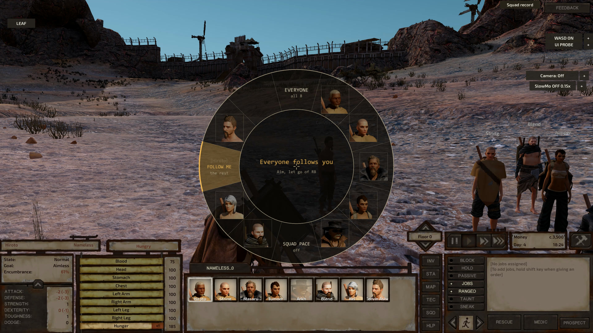
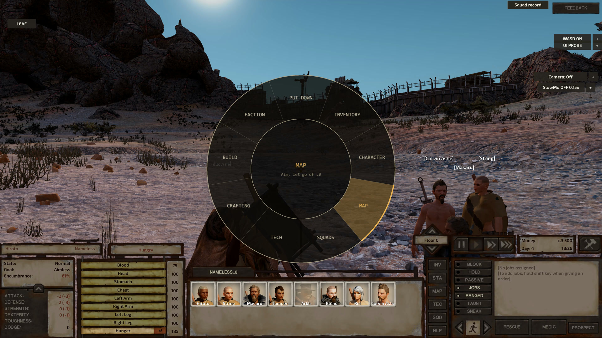

# PZA's WASD & Controller Support for Meitou (beta 0.11.0)

Play Meitou like a third-person game: steer your character yourself with **W A S D** or a **game controller** (Xbox, PlayStation,
Switch Pro and others), the camera following, with an over-the-shoulder view and a first-person view. Press **V** (or the pad's View / -
button) to switch it on and off; while it is off, Meitou plays as usual.

**Steam Workshop:** https://steamcommunity.com/sharedfiles/filedetails/?id=3841676799

**Download:** the mod zip and its source zip are on the [Releases page](https://github.com/PZA-Mods/PZAMeitouWASDController/releases). Building from source: [BUILD.md](BUILD.md).

## New in 0.11.0
- **[BETA] Jump:** Shift+U, or A with nothing under the crosshair. A hop from standing; walk and run jumps on the move. On / off in Settings > Mods.
- **[BETA] Ledges: Fall** (off by default): push on at a drop and you tumble over it as a ragdoll; jump at a drop to leap off. Legs are hurt
  by how hard you land. **R3 during a jump:** dive.
- **[BETA] Leap:** jump at a small gap, lip or low step and you leap across onto the ground beyond.
- D-pad left at normal speed: slow motion (PZA's SlowMo if installed, else 0.30x).
- The controller in the **title, Esc, save and load menus** (D-pad moves, A presses; an on-screen keyboard types save names) and in
  **conversations** and PZA's windows (D-pad picks, A says).
- First-person field of view slider; HIDE UI on the screens dial (menus still show).
- With PZA's Director's Kit: flick the right stick to step its locked camera a quadrant; its kill-cam shots take over the WASD views cleanly
  and hand back.
- Fixed on Meitou 0.22: L3 sneak and two orders-dial tasks pressed the wrong game action.
- No steering in cages and beds; a way out when stuck on rough ground.
- Window places and rebound keys now stay after a restart; loading a save or starting a new game no longer carries the last game's steering,
  slow motion or view over.
- **Weapon swapping:** the Orders dial's **third page is for swapping weapons** (AUTO = the game's pick, HIP weapon, FISTS). Fixed: a dial
  could stay stuck open.

**The jump, ledge-fall and dive features are BETA** and will likely be split off later into separate frameworks other mods can build on.

## In action

| Squad dial (hold RB) | Screens dial (hold LB) |
|---|---|
|  |  |

## Keyboard and mouse

| Key | What it does |
|---|---|
| **V** | WASD Control on / off |
| **W A S D** (or the arrows) | Move the first selected character, relative to the camera; let go and they stop. Stairs, walls and ledges are followed as with a right click |
| **Z** | Over-the-shoulder view on / off |
| **N** | First-person view on / off (look all the way round; your character turns with you) |
| **Mouse** | In a view: turns the camera; a small cross marks the middle, and left / right click act on what it is on (looking past your own character) |
| **G** | Point at one of your characters and press G: control moves to them |
| **Alt** (held) | Frees the mouse pointer |
| **X** | Meitou's own run speed (walk, jog, run, squad pace) |
| Q / E, middle mouse, wheel | Turn, tilt and zoom the camera as usual |

Ctrl and P are left alone on purpose (Meitou's camera orbit and photo mode). Nothing fires while you type in a text box. Trade, inventory
and loot windows free the pointer by themselves.

## Game controller

- **Left stick:** move. A light push walks, a medium push jogs, a full push runs (with squad pace on, the full push keeps the squad together).
- **Right stick:** look around, up and down too.
- **RT / ZR:** interact: a tap does what a right click does (attacks a hostile, talks to a friend, loots). **Hold ZR** for the full menu
  (stealth knockout and the other attacks too), aim with the stick, let go to pick.
- **A** (bottom button): **the safe action** for what the crosshair is on, named on a line under it: talk, trade, first aid, pick up, loot;
  open, close, lock a door; your own chest's inventory. Never an attack, a lockpick or a theft: those stay on hold RT. In a window (trade,
  inventory, loot, the map and the other screens) A is the click (the right stick moves the pointer there).
- **B** (right button): select / inspect; closes a window; cancels a dial.
- **Y / X:** over-the-shoulder view / first-person view.
- **LB / RB:** previous / next squad member.
  - **Hold LB** for the **screens dial:** map, inventory, character, squads, build, crafting, tech, faction, always in the same places;
    aim and let go to open, **B** cancels.
  - **Hold RB** for the **squad dial:** your squad's faces in a circle; aim and let go to take control, **B** cancels. Top: **everyone**. Bottom: **squad
    pace** on / off. Left: **follow me** (your character calls "Follow me!" and the rest of the squad follows you; choose it again and they
    stop). Big squads get pages (D-pad or LB).
  - **Hold LB + RB together** for the **orders dial:** **Stances** (Kenshi's eight orders: hold, block, passive, ranged, jobs, taunt,
    sneak, chase, each lit when on) and, on its second page (D-pad left / right), **Tasks:** stop, medic, rescue, prospect, put down,
    clear jobs, rest, select all. A slice that doesn't apply now is dimmed and stays in its place.
- **LT / ZL (hold):** highlight; with ZR: loot / steal. **LT + B:** stop.
- **L3:** sneak. **R3:** camera behind you; hold to look back.
- **D-pad:** zoom (normal view), game speed. **Menu / +:** pause; hold for the game menu. **View / -:** on / off.

**While a dial is open time runs at a quarter** (or Pause /
Normal, in the window); your own pause or speed change wins. Every pick is checked a moment later: if it changed nothing in the game, a
short note says so. While you use the controller, **a line at the top of the screen** says what its buttons do right now (setting
"Controller prompts").

The full layout is in the picture above and on the window's KEYS tab. A Switch Pro controller works best when Meitou is started through
Steam (as a non-Steam game), so Steam Input handles it.

## The window
Starts as a tiny **WASD ON / OFF** button (top right): click to switch, **+** opens the window, drag it, mouse wheel for its opacity. Tabs:
CONTROL (on / off, camera view, look speed, invert, shoulder side, time under a dial), KEYS (change the keys; the controller list) and HELP. Everything is also
on **Settings > Mods** under the mod's row.

## Requires
**Meitou 0.20.1 or newer** (checked on 0.20.1, 0.21.0 and 0.22.1). On a newer Meitou that lacks something it needs, it stays off and its
log line says what is missing.

## Install
- **Workshop:** subscribe, then tick **PZAWASDControlMeitou** in Meitou's mod list.
- **By hand (GitHub):** unpack `PZAWASDControl.Meitou-0.11.0-beta.zip` into Kenshi's folder (`Kenshi\mods\PZAWASDControl\`), then tick
  **PZAWASDControl** in Meitou's mod list.
- No items or world data; load order doesn't matter. Safe to remove at any time.

## This is a beta
The basics (walking, stairs, the views, the controller, ZR, the squad and screens dials, "Follow me!") were played a lot. **This build
(0.11.0) passed its offline checks on Meitou 0.20.1, 0.21.0 and 0.22.1, its fuzz tests and headless runs on 0.22.1; its newest parts are not played much yet:** the
orders dial on LB + RB, A's safe action, time slowing under a dial, the line of prompts at the top, and the checks after each pick. Tell us
how they feel.

Known limits:
- Removing a single job from a character's job list has no controller shortcut yet (CLEAR JOBS on the orders dial removes them all).
- A's safe action covers people, doors and your own containers; beds and buildings still go through RT.
- A right click on your own squad member in a view usually opens nothing (Meitou has no action for them there).
- The squad dial shows the squad bar's members, at most 30.
- Follow me's on / off only knows the follows it started itself.
- With Settings' Hardware mouse on there is no crosshair (the look still works).
- It steers one character at a time (the first selected one); the rest follow Meitou's own orders, or you (follow me).
- No manual combat (attack / block / dodge with keys); ZR gives the game's own attack orders.
- D-pad zoom works in the normal view only.
- Controller buttons cannot be rebound yet (keyboard keys can).
- Texts are in English only for now.

## Planned
Ideas, no dates: jobs on the controller (remove one from a dial; clearing them all is in), A's safe action for beds and buildings, actions for your own squad members in a view, mouse-wheel
steps into the views, vibration when your character is hit, texts in Russian, Chinese and Japanese.

## Reporting a bug
What happened, how to make it happen again, keyboard or which controller, your Meitou version and mod list, and Meitou's `log.txt` (in your
Meitou folder) copied right after that session. Our lines start with `pza.wasdcontrol`. Post it in its thread on the Meitou Discord or in the
Workshop page's Bug reports discussion.

## Licence and source
GNU GPL version 3 or later; the source is attached to the release (`-source.zip`). Made by **PZA**. Inspired by Direct Control for Kenshi
(smokefoolius); no code shared. Thanks to **BeatTheCount**, whose Gamepad mod for Meitou gave us the ideas of a safe extra button named on
screen, lighting the stances from your character's orders, and the line of prompts; we rewrote them in our own code. Unofficial fan-made mod; not affiliated with Lo-Fi Games.
